# 01 — Modèle conceptuel de données global

**Projet :** ERP scolaire  
**Version :** V1.0  
**Statut : MCD GLOBAL V1.0 — CONSOLIDÉ, AUDITÉ, EN ATTENTE DE VALIDATION FORMELLE DU PROPRIÉTAIRE.** Les domaines 1 à 3 et les lots financiers 1 à 5 restent validés et gelés selon leurs décisions antérieures; le lot 7 reste gelé sous VAL-013, le lot 8 sous VAL-014 et le domaine pédagogique sous VAL-015. Ces validations spécialisées ne valent pas validation du MCD global.

## 1. Objet et statut de conception

Cette vue consolide les concepts documentés pour les domaines 1 à 5 et les lots financiers présents dans les sources. Elle ne remplace aucun MCD spécialisé gelé. Elle ne constitue pas un MLD et ne définit ni attributs physiques, ni clés, ni SQL.

État normatif consolidé : domaines 1 à 3 et lots 1 à 5 validés et gelés; orientations du lot 6 provisoires avec quatre points ouverts; lot 7 V1.0 gelé sous VAL-013; lot 8 V1.0 validé et gelé sous VAL-014; domaine pédagogique V1.0 gelé sous VAL-015. Ces validations spécialisées ne valent pas validation du MCD global V1.0.

Les documents disponibles ne ventilent pas les concepts financiers historiques par lot. Les orientations métier du lot 6 fournies pour cette consolidation sont intégrées comme provisoirement acceptées en V0.9.1, sans être considérées comme gelées.

## 2. Domaines et concepts consolidés

### Domaine 1 — Organisation scolaire

Définit l'établissement propriétaire et le cadre académique : année scolaire, période pédagogique, cycle et niveau d'enseignement, modèle de classe et classe annuelle. Le domaine organisationnel applique administrativement les décisions de progression propriétaires du domaine pédagogique.

### Domaine 2 — Gestion des élèves

Porte le dossier permanent de l'élève, distinct de ses inscriptions annuelles, les responsables, la relation élève-responsable et les documents associés.

### Domaine 3 — Inscriptions et parcours scolaire

Porte les candidatures, préinscriptions, inscriptions confirmées, affectations aux classes et changements de classe. Une candidature ne devient un dossier permanent qu'après admission. Il applique administrativement les décisions de progression du domaine pédagogique et ne possède pas une seconde entité de décision.

### Domaine 4 — Gestion financière

Concepts déjà recensés : frais scolaires, créance, paiement, affectation de paiement, crédit, annulation financière, remboursement, session de caisse et mouvement de caisse. Les orientations provisoirement acceptées du lot 6 couvrent également l'annulation d'encaissement, la contrepassation, l'avoir, `RESERVATION_CREDIT`, les crédits brut/réservé/net calculés, la restitution et le mandat de restitution. Leur cohérence est détaillée dans les documents spécialisés.

Le lot 6 reste provisoire et non gelé, avec quatre points ouverts. Le lot 7 est gelé sous VAL-013; le lot 8 est gelé sous VAL-014. Leurs décisions respectives ne sont pas modifiées sans demande explicite et traçabilité.

### Domaine 4 — Lot 7 : soldes, impayés et relevés

MCD V1.0 validé et gelé sous VAL-013. Les concepts de relance financière, ligne de relance, destinataire de relance, paramétrage versionné de balance âgée et tranche de balance âgée appartiennent au périmètre gelé. Les situations financières, restes à payer, balances âgées, relevés dynamiques et synthèses restent des résultats calculés, non des entités persistantes.

Le lot 7 réutilise les entités historiques `CREANCE`, `PLAN_REGLEMENT_CREANCE`, `ECHEANCE_CREANCE`, `ENCAISSEMENT`, `AFFECTATION_REGLEMENT`, `MOUVEMENT_CREDIT`, `SESSION_CAISSE`, `MOUVEMENT_CAISSE`, `CLOTURE_CAISSE` et `RAPPROCHEMENT_CAISSE`, sans en modifier les décisions. Leurs attributs et cardinalités détaillés ne sont pas présents dans les sources du dépôt. Les responsables et autorisations sont réutilisés depuis le domaine 2; la représentation précise des responsabilités financières actives n'est pas documentée.

### Domaine 5 — Gestion pédagogique

Le MCD pédagogique V1.0 est validé et gelé sous VAL-015. Ses concepts, relations, cardinalités, arbitrages PED-A01 à PED-A10 et précisions PED-I01 à PED-I03 sont repris sans modification depuis `09-dossier-pedagogique-preliminaire.md`. Le document 09 conserve son contenu spécialisé; son ancienne mention d'attente de validation est antérieure à VAL-015 et n'est pas reprise comme statut courant. Le MCD global demeure en attente de validation formelle.

### Domaine 4 — Lot 8 : synchronisation Offline-First

MCD V1.0 validé et gelé sous VAL-014. Le lot 8 transporte les événements produits par les entités des lots 1 à 7 sans en dupliquer les faits métier. Ses 17 concepts et associations, ses relations et cardinalités, ses règles RM-SYNC-01 à RM-SYNC-38 et ses invariants SYNC-001 à SYNC-083 sont définis dans `08-mcd-consolide-lot8.md`. La vue globale ci-dessous n'en donne qu'un inventaire; les relations complètes sont celles des sections 3 et 4 du document de référence.

## 3. Vue conceptuelle des relations connues

Les traits pleins représentent les liens exprimés dans les documents. Les traits pointillés représentent des dépendances ou rattachements dont l'existence fonctionnelle est évoquée, mais dont la relation exacte ou la cardinalité reste à préciser. Le diagramme n'est pas un diagramme de cardinalités.

```mermaid
flowchart LR
        subgraph D1["Domaine 1 — Organisation scolaire"]
                AS[Année scolaire]
                PP[Période pédagogique]
                CE[Cycle d'enseignement]
                NE[Niveau d'enseignement]
                MC[Modèle de classe]
                CA[Classe annuelle]
                AS --> PP
                AS --> CA
                CE --> NE
                NE --> CA
                MC --> CA
        end

        subgraph D2["Domaine 2 — Gestion des élèves"]
                EL[Élève — dossier permanent]
                RE[Responsable]
                REL[Relation élève-responsable]
                DE[Document élève]
                EL --- REL
                RE --- REL
                EL --- DE
        end

        subgraph D3["Domaine 3 — Inscriptions et parcours"]
                CD[Candidature]
                PI[Préinscription]
                IN[Inscription confirmée]
                AF[Affectation à une classe]
                HC[Historique de changement de classe]
                CD -. "après admission" .-> EL
                PI -. "candidat ou élève connu, jamais les deux" .-> CD
                PI -. "candidat ou élève connu, jamais les deux" .-> EL
                IN --> EL
                IN --> AS
                IN -. "affectation éventuellement différée" .-> CA
                IN --- AF
                AF --- HC
        end

                subgraph D4["Domaine 4 — Finances, lot 6 provisoire, lots 7 et 8 gelés"]
                FS[Frais scolaires]
                CR[CREANCE]
                PRC[PLAN_REGLEMENT_CREANCE]
                EC[ECHEANCE_CREANCE]
                EN[ENCAISSEMENT]
                AR[AFFECTATION_REGLEMENT]
                AN[Annulation d'encaissement]
                CP[Contrepassation]
                RB[Remboursement]
                AV[Avoir]
                CAO[Opération CREATION_AVOIR]
                AC[Crédit distinct issu de l'avoir]
                CB[Crédit brut calculé]
                CRV[Crédit réservé calculé]
                CN[Crédit net calculé]
                MC[MOUVEMENT_CREDIT]
                RC[RESERVATION_CREDIT]
                RT[Restitution]
                MR[Mandat de restitution]
                SC[SESSION_CAISSE]
                MCV[MOUVEMENT_CAISSE]
                CC[CLOTURE_CAISSE]
                RCX[RAPPROCHEMENT_CAISSE]
                subgraph L7["Lot 7 — MCD V1.0 gelé VAL-013"]
                        RF[Relance financière]
                        LRF[Ligne de relance financière]
                        DR[Destinataire de relance financière]
                        TT[TENTATIVE_TRANSMISSION_RELANCE — selon disponibilité du service partagé]
                        PBA[Paramétrage de balance âgée — versionné]
                        TBA[Tranche de balance âgée]
                        DG[Document généré — artefact, non comptable]
                        RES[Résultats calculés : RAP, situation, balance âgée, relevé, synthèse]
                        RF --> LRF
                        RF --> DR
                        DR --> TT
                        RF -. "élève concerné" .-> EL
                        PBA --> TBA
                        LRF -. "cible exclusive : CREANCE ou ECHEANCE_CREANCE" .-> CR
                        LRF -. "cible exclusive : CREANCE ou ECHEANCE_CREANCE" .-> EC
                        RES -. "calcul à date de référence" .-> EC
                        PBA -. "version appliquée" .-> RES
                        RES -. "peut être conservé comme artefact" .-> DG
                end
                CR -. "dépendance antérieure; cardinalité non documentée" .-> PRC
                PRC -. "dépendance antérieure; cardinalité non documentée" .-> EC
                EN -. "relation historique; cardinalité à vérifier" .-> AR
                AR -. "cible exclusive à confirmer" .-> CR
                AR -. "cible exclusive à confirmer" .-> EC
                EN -.-> RES
                AR -.-> RES
                EC -.-> RES
                AN -.-> RES
                CP -.-> RES
                RB -.-> RES
                RC -.-> RES
                MC -->|"id_mouvement_credit_source"| RC
                AV -. "peut produire" .-> CAO
                CAO -.-> AC
                RT --- MR
                subgraph L8["Lot 8 — MCD V1.0 gelé VAL-014"]
                        L8DEV[APPAREIL_SYNCHRONISATION]
                        L8INST[INSTALLATION_LOCALE]
                        L8FLUX[FLUX_SYNCHRONISATION]
                        L8OP[OPERATION_SYNCHRONISATION]
                        L8EVT[ENVELOPPE_EVENEMENT_SYNCHRONISATION]
                        L8DEP[DEPENDANCE_EVENEMENT_SYNCHRONISATION]
                        L8CUR[CURSEUR_SYNCHRONISATION]
                        L8CON[CONFLIT_SYNCHRONISATION]
                        L8ACE[ASSOCIATION_CONFLIT_EVENEMENT]
                        L8ACO[ASSOCIATION_CONFLIT_OPERATION]
                        L8DEC[DECISION_ARBITRAGE_SYNCHRONISATION]
                        L8TRANS[TRANSITION_APPLICABILITE_DECISION]
                        L8APP[APPLICATION_DECISION_ARBITRAGE]
                        L8BAK[SAUVEGARDE_LOCALE]
                        L8RST[OPERATION_RESTAURATION]
                        L8REC[ASSOCIATION_RECUPERATION_EVENEMENT]
                        L8TENT[TENTATIVE_TRANSMISSION_SYNCHRONISATION]
                end
        end

        REL -. "destinataires selon responsabilités financières actives et autorisations; définition D2 à vérifier" .-> DR

        subgraph D5["Domaine 5 — Pédagogie, MCD V1.0 gelé sous VAL-015"]
                PG[Programme/version/matière]
                EN[Enseignement/affectation enseignant]
                EV[Évaluation]
                NO[Note/révisions]
                RS[Résultats agrégés : matière, période, annuel]
                CN[CONTRIBUTION_RESULTAT_NOTE]
                CR[CONTRIBUTION_RESULTAT_SCOLAIRE]
                BU[Bulletin/lignes]
                CC[Conseil/avis]
                SU[Suivi pédagogique]
                DP[Décision de progression — propriétaire pédagogique]
                PG -.-> EN
                EN -.-> EV
                EV -.-> NO
                NO -.-> CN
                CN -.-> RS
                RS -. "résultat cible" .-> CR
                RS -.-> BU
                CC -. "avis distinct" .-> DP
                RS -. "source d'aide à la décision" .-> DP
                EL -. "décision individualisée; application administrative organisationnelle" .-> DP
                EN -.-> SU
        end
        CA -. "contexte de classe existant; cardinalités gelées sous VAL-015" .-> EN
        IN -. "inscription source" .-> NO
        IN -. "périmètre individuel" .-> RS
```

Les relations des lots 1 à 5 sont des dépendances antérieures fournies : `CREANCE` → `PLAN_REGLEMENT_CREANCE` / `ECHEANCE_CREANCE`, `ENCAISSEMENT` → `AFFECTATION_REGLEMENT` → cible financière, et `MOUVEMENT_CREDIT` → mécanisme de réservation du lot 6. Les cardinalités exactes ne sont pas documentées ici et ne sont pas redéfinies. Le RAP et la balance âgée courants se calculent par échéance active; une créance et ses échéances ne sont jamais additionnées deux fois. Une ligne de relance cible exactement une `CREANCE` ou une `ECHEANCE_CREANCE`, jamais les deux; une relance ne contient pas simultanément une créance globale et les échéances qui la composent. Les liens entre paiement et créance et leurs cardinalités ne sont pas déduits au-delà des dépendances historiques fournies.

Pour le lot 6, l'annulation d'encaissement, la contrepassation et le remboursement sont des opérations distinctes; l'annulation est orchestrée et bloquante. Les crédits brut, réservé et net sont des valeurs calculées, pas des montants indépendants modifiables. Une réservation référence directement un mouvement positif source via `id_mouvement_credit_source`; elle ne référence pas `CREDIT_DISPONIBLE` et ne réduit pas le crédit brut. `CREATION_AVOIR` peut produire un crédit distinct sans réécrire l'opération d'origine. Les mandats de restitution préservent la granularité de provenance des fonds. Le diagramme ne fixe pas d'autres multiplicités.

Pour le lot 7, les concepts du sous-graphe relèvent du MCD gelé sous VAL-013; leurs libellés ne sont pas des noms physiques arrêtés. `ECHEANCE_CREANCE` est réutilisée comme échéance source; les calendriers actifs/antérieurs viennent du plan de règlement antérieur, dont la règle détaillée de validation n'est pas disponible ici. Une relance porte sur un élève et peut avoir plusieurs destinataires; le MCD gelé retient `TENTATIVE_TRANSMISSION_RELANCE` comme journal enfant en l'absence d'un service transversal durable qui fournisse cette garantie. Le document généré est un artefact conservé, pas une écriture comptable.

Le sous-graphe du lot 8 inventorie ses 17 concepts et associations, sans substituer de relations implicites au modèle validé. Les relations, cardinalités, règles, invariants et scénarios exacts restent ceux de `08-mcd-consolide-lot8.md`; ses choix techniques et opérationnels ouverts ne remettent pas en cause le gel conceptuel.

Le RAP est calculé comme `Montant dû ajusté - Affectations nettes actives`; un résultat négatif est une anomalie. Le crédit net correspond au crédit brut diminué des réservations centrales actives. Les balances âgées utilisent une date de référence (date du jour par défaut), le fuseau `Africa/Brazzaville` et un paramétrage versionné; les valeurs calculées ne deviennent pas des entités persistantes.

## 4. Séparations et absence de doublons conceptuels

- L'élève permanent est distinct de chaque inscription annuelle.
- L'année scolaire est distincte des périodes pédagogiques.
- Le modèle de classe est distinct de la classe annuelle.
- La candidature est distincte de l'inscription confirmée.
- La créance, le paiement et son affectation sont des concepts distincts.
- Annulation d'encaissement, contrepassation et remboursement sont des opérations distinctes; l'annulation est orchestrée et bloquante.
- Les crédits brut, réservé et net sont calculés; ils ne sont pas des montants indépendants modifiables. `CREDIT_DISPONIBLE` n'est pas retenu comme entité de référence.
- `RESERVATION_CREDIT` pointe directement vers le mouvement positif source par `id_mouvement_credit_source`; une réservation ne diminue pas le crédit brut.
- Un avoir peut produire un crédit distinct par `CREATION_AVOIR` sans modifier rétroactivement l'opération d'origine.
- La provenance des fonds reste traçable au niveau de granularité requis par les mandats de restitution.
- « Décision de progression » est un concept unique. PED-A08 attribue la propriété de la décision au domaine pédagogique et son application administrative au domaine organisation scolaire; cela ne duplique pas la décision ni ne modifie les domaines 1 à 3.
- Le MCD pédagogique V1.0 est distinct et gelé sous VAL-015; il ne remplace pas les référentiels des domaines 1 à 3. La décision de progression a un propriétaire pédagogique; son application administrative appartient à l'organisation scolaire. Les modèles sources détaillés des lots financiers 1 à 5 restent une limite documentaire et ne sont pas reconstruits.

## 5. Isolation des établissements et identifiants

L'établissement est la frontière de propriété des données métier. La V1 prévoit un établissement par déploiement; plusieurs appareils et leurs installations locales peuvent relever de cet établissement. Aucune entité générique de tenant ni relation artificielle vers l'établissement n'est ajoutée à chaque concept. Toute entité métier doit être rattachable à un seul établissement par une relation directe déjà prévue par son domaine ou par un chemin conceptuel non ambigu vers son propriétaire.

Les concepts du lot 8 suivent les rattachements gelés sous VAL-014 : l'appareil est rattaché à un établissement; l'installation en hérite par l'appareil; les flux et opérations locaux en héritent par l'installation, tandis que les flux et opérations émis par le serveur portent le contexte d'établissement; un événement est cohérent avec son opération et son flux d'origine. Le serveur refuse une transmission dont l'établissement ne correspond pas au contexte d'autorisation. La restauration et la récupération restent dans l'établissement propriétaire de la sauvegarde et des événements.

Pour les autres domaines, une référence entre objets doit rester dans l'établissement propriétaire déterminé par les relations validées du domaine. Les relations directes supplémentaires ne sont pas inférées lorsque le propriétaire est déjà déterminable. Les documents sources des lots 1 à 5 étant absents, leur mécanisme précis de rattachement et de contrôle inter-entités reste à vérifier sur les modèles historiques; aucun attribut ou lien n'est ajouté ici.

Les UUID sont des identifiants techniques globaux et stables compatibles avec la création locale et la synchronisation. Ils sont distincts des identifiants métier locaux. Le matricule d'élève est unique à l'échelle de l'établissement et non réattribuable; aucune autre portée d'identifiant métier n'est inventée faute de règle documentée.

## 6. État de validation et suite

Les domaines 1 à 3 et les lots financiers 1 à 5 sont validés et gelés selon leurs décisions antérieures. Le lot 6 reste provisoire avec quatre points ouverts; le lot 7 est gelé sous VAL-013, le lot 8 sous VAL-014 et le domaine pédagogique sous VAL-015. Ce document ne déclare pas le MCD global V1.0 validé.

Le lot 7 est **MCD V1.0 gelé sous VAL-013**, le lot 8 est **MCD V1.0 gelé sous VAL-014**, et le domaine pédagogique est **MCD V1.0 gelé sous VAL-015**; leurs décisions ne doivent pas être modifiées sans décision explicite et traçabilité. Le présent MCD global est consolidé et audité, mais attend la validation formelle du propriétaire. Aucun MLD ni SQL n'est produit.
